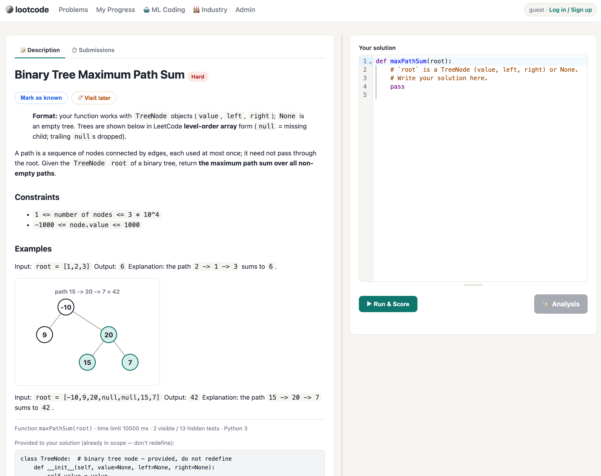
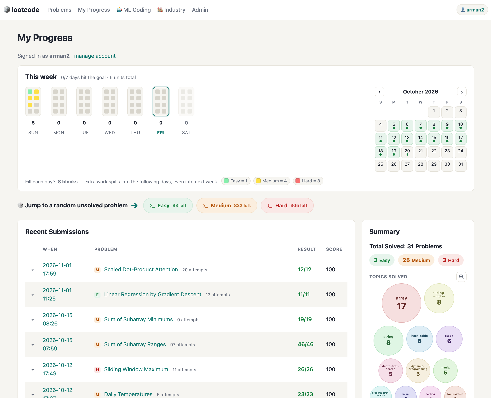
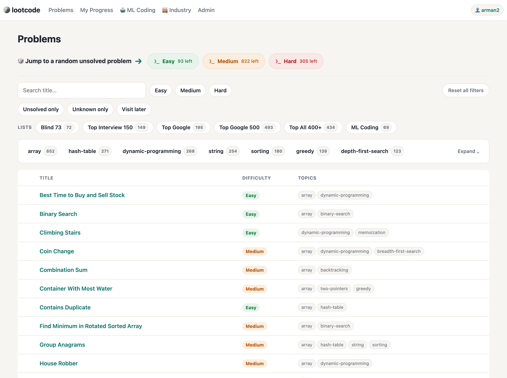

<div align="center">

# 🪙 lootcode

**Practice coding exercises, write a solution, run it against tests, get scored.**

A lightweight, self-hostable LeetCode-style platform for your home or LAN server.
Python 3 · FastAPI · SQLite · 800+ problems.



</div>

---

## Features

### Practice
- **800+ problems**, each with a verified reference solution, visible examples and hidden tests.
- **Browse and filter** by difficulty, topic (45 canonical tags, with an *exclude topic* filter), title search and status. Mark problems as **known** or save them to **visit later**.
- **Curated collections**: *Blind 73*, *Top Interview 150*, *Top Google*, *Top Google 500*, *Top All 400+* and *ML Coding*.
- **In-browser Python editor** (CodeMirror) with per-problem starter code, plus up to **3 progressive hints** that nudge you without giving the answer away.
- **Readable statements**: LaTeX math rendered with KaTeX, and diagrams for problems that need one.

### Problem types
- **Function problems**: the classic "write `twoSum(nums, target)`" format.
- **Design problems**: implement a stateful class (LRU Cache, Min Stack, Browser History…), graded by replaying a sequence of method calls on one instance.
- **Real data structures**: tree and linked-list problems give your code actual `TreeNode`, `ListNode` and doubly-linked `Node` objects, built the LeetCode way, so you write pointer code instead of parsing arrays.
- **ML coding**: 69 implement-from-scratch machine-learning problems (attention, optimizers, losses, metrics…) using **numpy**, graded with a floating-point tolerance.

### Run and score
- **Run against every test**, visible and hidden, with weighted scoring and feedback on each visible test. Hidden tests are counted but never shown.
- **Answer-aware judging**: exact match, any order, set of lists, or float-tolerant, whichever the statement promises.
- **Sandboxed execution**: per-test time limits, a memory cap, a process cap (no fork bombs), an output cap and a throwaway working directory. Two backends: `subprocess` (default, no dependencies) and `docker` (network disabled, stronger isolation).

### AI assistance *(optional)*
- **✨ Get More Help with AI**: still stuck after the stored hints? Get one extra, more specific hint, streamed live.
- **✨ Analysis**: a LeetCode-style review of the code in your editor. It covers your approach and the suggested one, time and space complexity, and code style. Your code is graded first, so the review knows whether it actually passes.
- Works with **any OpenAI-compatible endpoint** (for example a local llama.cpp server). The buttons turn on and off automatically as the server comes and goes.

### Progress
- **No-password profiles**: a cookie gives every visitor their own identity right away. Optional username/password accounts carry your progress across devices, and your guest progress is merged in when you sign up.
- **My Progress**: a weekly goal tracker (Easy = 1, Medium = 4, Hard = 8 units; extra work carries over to the next days), a monthly calendar, recent submissions, and solved totals by difficulty and topic.

### Industry Coding Framework *(optional extension)*
Timed, four-level assessments in the shape used by real hiring loops. You implement **one class**. Each level adds requirements while the earlier ones must keep passing, and a level unlocks only when all of its tests, visible *and* hidden, pass, all against a 90-minute clock. It lives entirely in `icf/`: delete the folder and lootcode works exactly as before. See [`icf/README.md`](icf/README.md).

### Admin
- **Add or edit problems** in a form. Every save runs the same checks: slug, structure, canonical tags, statement ↔ judge consistency, and the reference solution passing all tests.
- **Generate with AI**: turn an idea into a statement, then the statement into a full problem (contract, solution, tests, hints). A duplicate check runs first, and nothing is saved until you review it.



## Getting started

```bash
git clone <this-repo> && cd lootcode
python3 -m venv .venv && . .venv/bin/activate
pip install -r requirements.txt
uvicorn app.main:app --reload
```

Open **http://127.0.0.1:8000**. On first run the SQLite database is created and
seeded from `content/problems/` automatically. There are no extra steps.

**Reach it from other devices on your LAN.** lootcode has no authentication, so
binding to anything other than localhost has to be an explicit choice (see
[`docs/security.md`](docs/security.md)):

```bash
LOOTCODE_TRUST_LAN=1 uvicorn app.main:app --host 0.0.0.0 --port 8000   # visit http://<server-ip>:8000
```

**Optional: AI features.** Copy `.env.example` to `.env`, then set:

| Variable | Enables |
|----------|---------|
| `LLM_HELP_URL` (+ `LLM_HELP_MODEL`, `LLM_HELP_API_KEY`) | An OpenAI-compatible endpoint for *Get More Help*, *Analysis* and *Generate with AI* (default `http://localhost:8080`). |
| `ANTHROPIC_API_KEY` | The Claude API for the idea → statement step of *Generate with AI* (preferred when set). |

**Other ways to run:** `docker compose up` (see `docker-compose.yml`), or the
Make shortcuts `make install`, `make dev`, `make run` and `make test`. Set
`EXECUTOR_BACKEND=docker` to run submissions in the Docker sandbox.



## Development

Running the checks, managing the problem bank, and a map of what's in this
repo are covered in **[docs/development.md](docs/development.md)**. For status
and what's next, see [docs/roadmap.md](docs/roadmap.md).

## License

[MIT](LICENSE).

---

*lootcode was developed fully by [Claude](https://claude.com/claude-code) (Anthropic): the application code, the problem bank, and these docs.*
